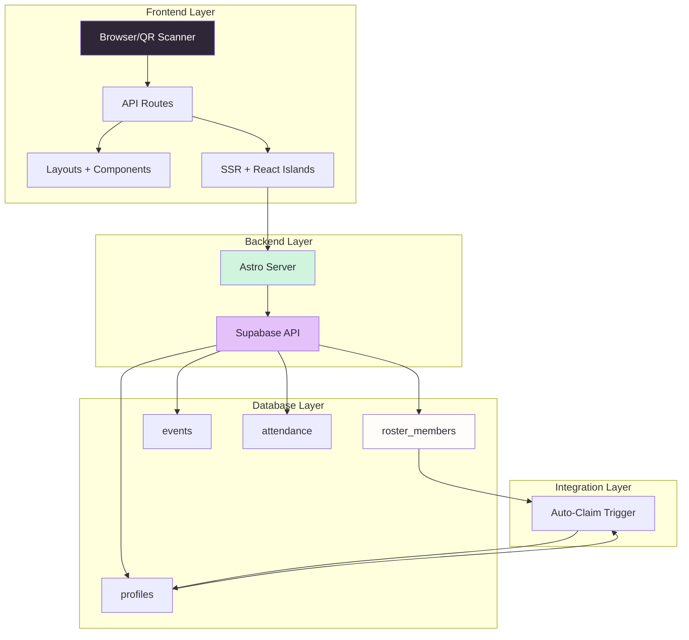
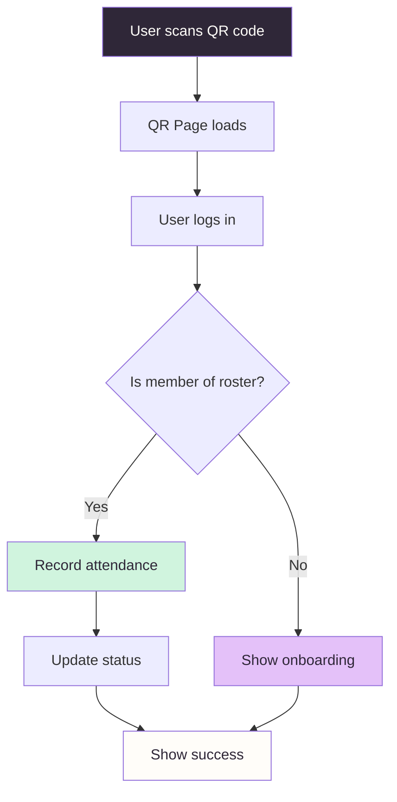
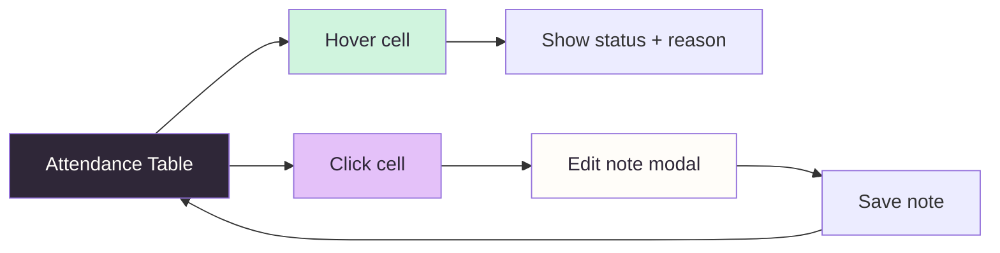

# QRoll

<div align="center">


**A QR-based attendance tracker for recurring events — built for clubs and teams that need to know who showed up, who was late, and why.**

</div>

<div align="center">


[](https://discord.gg/xxxxxxxxxxxx)

</div>

## Overview

A beautiful, modern attendance tracking solution designed specifically for QRoll — the Active Canvas experience. Members scan an event-specific QR code to check in. Admins manage a roster, import historical attendance, and review a per-member matrix that highlights absences with editable notes.

## Quick Actions

| Command           | Action                                      |
| ----------------- | ------------------------------------------- |
| `npm run dev`     | Start local dev server at `localhost:4321`  |
| `npm run build`   | Production build (Vercel-targeted)          |
| `npm test`        | Run Vitest unit tests                       |
| `npx astro check` | Astro + TypeScript diagnostics              |

## ✨ Features

- **One-tap check-in** — Scan, sign in with Google, done. Status auto-classifies as present, late, or absent based on per-event time windows.
- **Roster-first model** — Members live in a `roster_members` table independent of auth. When someone signs up with a matching email, an auto-claim trigger links their account to historical records.
- **Historical import** — Past attendance from spreadsheets imports as real events (without QR tokens), so the analytics view shows one continuous timeline.
- **Attendance matrix** — Hover any cell for status + reason; admins click to add or edit notes. Notes persist via a server-side API.
- **Analytics dashboard** — Top attendees, least active, most-late-arrivals, on-time rate, and a per-event stacked bar.
- **Admin roster CRUD** — Add members, set emails to enable auto-claim, manually link a roster row to an existing profile, or delete.

## 🛠️ Tech Stack

<div align="center">

| Frontend | Backend | Deployment | CI & Tools |
|----------|---------|------------|-----------|
| [](https://astro.build) | [](https://supabase.com) | [](https://vercel.com) | [](https://github.com/features/actions) |
| [](https://react.dev) | [](https://www.postgresql.org) | [](https://www.typescriptlang.org) | [](https://vitest.dev) |
| [](https://tailwindcss.com) | [](https://zod.dev) | [](https://vercel.com/docs/concepts/astro) | [](https://eslint.org) |

</div>

## 📋 Getting Started

### Prerequisites

- Node.js 24+ (Vercel runtime; `>=22.12` works locally for dev)
- A Supabase project ([create one](https://supabase.com/dashboard/projects))
- The Supabase CLI (`brew install supabase/tap/supabase`)

### 1. Setup Environment

```bash
cd /path/to/your/projects
```

### 2. Clone & Install

```bash
git clone https://github.com/michelle-zhuang/QRoll.git
```

```bash
cd QRoll
npm install
```

### 3. Configure Environment

```bash
cp .env.example .env
```

**Edit `.env`** with your Supabase project's API settings:

```env
PUBLIC_SUPABASE_URL=https://<project-ref>.supabase.co
PUBLIC_SUPABASE_ANON_KEY=<anon-key>
SUPABASE_SERVICE_ROLE_KEY=<service-role-key>   # optional, server-only utilities
PUBLIC_APP_URL=http://localhost:4321
```

> **Security Note:** The anon key is intended to be public **only when row-level security is enabled**. Configure RLS policies before exposing the app publicly.

### 4. Apply Database Schema

```bash
supabase link --project-ref <project-ref>
supabase db push
```

This applies the production schema migrations:

- `20260520210000_roster_and_historical.sql` — roster, attendance updates, auto-claim trigger
- `20260520210001_seed_historical_data.sql` — 45 example roster members + 21 historical events + 566 attendance records (idempotent)

**For empty database:** Delete the seed migration before pushing.

### 5. Configure Authentication

In your Supabase Dashboard → Authentication → Providers → Google:

- Add your OAuth client ID and secret
- Set redirect URL to `http://localhost:4321/api/auth/callback` (and your Vercel URL for production)

### 6. Start Development

```bash
npm run dev
```

Visit [http://localhost:4321](http://localhost:4321) to experience the Active Canvas.

## 🏗️ Architecture



## 📁 Project Structure

```
.
├── .github/
│   ├── workflows/                # GitHub Actions
│   └── pull_request_template.md
├── .vercel/                      # Vercel config
├── docs/                         # Documentation
├── public/                       # Static assets
│   └── assets/                  # QRoll brand assets
├── src/
│   ├── components/              # React + Astro UI
│   ├── layouts/                 # Layout.astro with nav + auth context
│   ├── lib/                     # supabase client, time logic, attendance types
│   └── pages/                   # All Astro routes
│       ├── api/                 # Server endpoints
│       ├── admin/               # Event management
│       ├── checkin/             # QR scan landing pages
│       ├── dashboard.astro      # Analytics + matrix views
│       └── login.astro
├── supabase/
│   ├── migrations/              # Database migrations
│   └── config.toml             # Supabase config
├── styles/                      # CSS & design tokens
├── tsconfig.json               # TypeScript config
└── package.json                # Dependencies & scripts
```

## 🎨 Design System

The "Active Canvas" design system features:

- **Primary Color:** `#2F2738` (Eggplant Ink)
- **Secondary:** `#D0F4DE` (Fresh Mint)
- **Accent:** `#E4C1F9` (Soft Lavender)
- **Background:** `#FFFDF9` (Warm Milk)
- **Card BG:** `#FFFFFF` (Card White)
- **Border:** `#ECE6F2` (Pale Lilac)

**Key Design Rules:**
- Pill-shaped components with `12px` border-radius
- Generous spacing (`24px` padding on cards)
- Soft shadows (`Halo Glow` effect)
- System-based typography hierarchy

## 📊 Database Schema

```mermaid
diagram TD
    subgraph "Core Tables"
        P[profiles] --> PM[roster_members] : "Auto-Claim Trigger"
        PM --> A[attendance] : "One-to-Many"
        PM --> E[events] : "Many-to-One (row level)"
    end
    
    subgraph "profiles Fields"
        P --> "id (auth.users.id)"
        P --> "email"
        P --> "full_name"
        P --> "role"
    end
    
    subgraph "roster_members Fields"
        PM --> "id"
        PM --> "email (unique)"
        PM --> "full_name"
        PM --> "claimed_user_id"
        PM --> "notes (nullable)"
    end
    
    subgraph "events Fields"
        E --> "id"
        E --> "title"
        E --> "starts_at"
        E --> "checkin_starts_at"
        E --> "checkin_ends_at"
        E --> "qr_token (nullable)"
        E --> "is_historical (bool)"
    end
    
    subgraph "attendance Fields"
        A --> "id"
        A --> "status"
        A --> "note (nullable)"
        A --> "checked_in_at"
        A --> "ip_address"
        A --> "user_agent"
    end

    style P fill:#2F2738,color:#FFFDF9
    style PM fill:#F5EFFA,color:#2F2738
    style E fill:#E4C1F9,color:#2F2738
    style A fill:#D0F4DE,color:#2F2738
```

## 🔄 Workflow Diagrams

### Check-in Flow



### Admin Attendance Matrix



## 🚀 Deployment

QRoll is production-ready on **Vercel**:

### CI/CD Pipeline

[](https://github.com/michelle-zhuang/QRoll/actions/workflows/ci.yml)

**CI checks on every push/PR:**

- ✅ `astro check` — type errors block the merge
- ✅ `vitest run` — unit tests must pass
- ✅ `astro build` — build must succeed

### Vercel Configuration

The `vercel.json` file configures:

```json
{
  "framework": "astro",
  "buildCommand": "astro build",
  "outputDirectory": ".astro/server/output",
  "version": 3
}
```

### Branch Strategy

| Branch | Purpose |
|--------|---------|
| `main` | Production releases |
| `preview` | Feature previews |
| Feature branches | Development work |

## 🤝 Contributing

[](https://github.com/michelle-zhuang/QRoll/graphs/contributors)

### Prerequisites

- [GitNexus](https://github.com/michelle-zhuang/QRoll/pkgs/gitnexus) - Code intelligence and impact analysis
- Node.js 24+
- Supabase CLI

### Code Quality

1. **Run impact analysis before any changes:**
   ```bash
   npx gitnexus impact --target "functionName"
   ```

2. **Run tests:**
   ```bash
   npm test
   ```

3. **Type checking:**
   ```bash
   npx astro check
   ```

### PR Process

The GitHub PR template includes a readiness checklist covering code, security, database, UI, and deployment aspects. Please ensure all items are completed before requesting review.

### Code Standards

- Follow the "Active Canvas" design system
- Maintain clean, readable code with TypeScript
- Write unit tests for new functionality
- Update documentation for new features

## 📄 License

<div align="center">

[MIT License](LICENSE)

© 2024 Michelle Zhuang

</div>

## 🔗 Quick Links

<div align="center">

[](https://github.com/michelle-zhuang/QRoll)
[](https://github.com/michelle-zhuang/QRoll/wiki)
[](https://github.com/michelle-zhuang/QRoll/releases)
[](https://github.com/michelle-zhuang/QRoll/issues)

</div>

---

*

Designed with ❤️ for the "Active Canvas" experience using QRoll's design system.*

*
