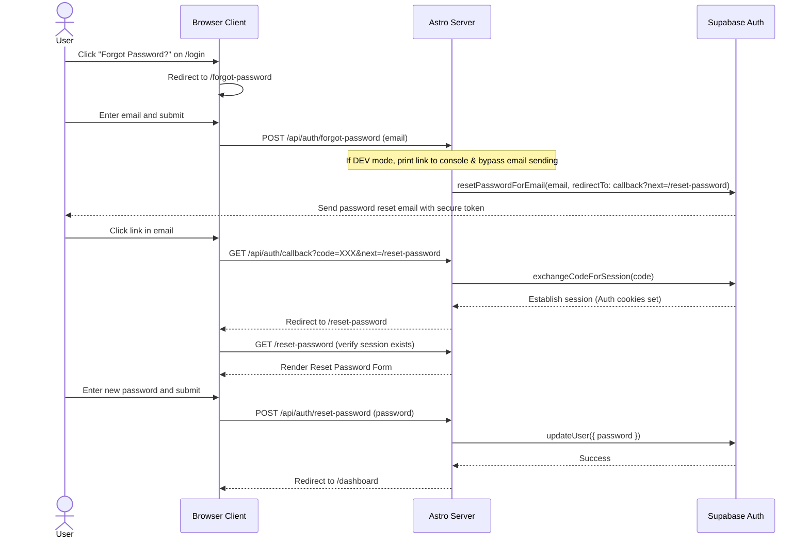

# Spec: Forgot Password Flow for Email Signups

This document outlines the design and implementation specifications for adding a forgot/reset password flow for users signed up via email/password.

## 1. Overview
Currently, QRoll allows signing in/up with Google OAuth or with Email/Password. However, there is no way for email-based users to recover or reset their password if forgotten. We will implement a secure password reset flow powered by Supabase Auth and integrated into QRoll's existing design system.

---

## 2. Sequence Flow



---

## 3. Backend Implementation

### 3.1. API Route: Send Reset Link
*   **File Path:** `/src/pages/api/auth/forgot-password.ts`
*   **Method:** `POST`
*   **Functionality:**
    1.  Parse email from form data.
    2.  Instantiate Supabase server client.
    3.  Call `supabase.auth.resetPasswordForEmail(email, { redirectTo: `${baseUrl}/api/auth/callback?next=/reset-password` })`.
    4.  Return `200 OK` with confirmation message.

### 3.2. API Route: Reset Password Action
*   **File Path:** `/src/pages/api/auth/reset-password.ts`
*   **Method:** `POST`
*   **Functionality:**
    1.  Parse `password` from form data.
    2.  Instantiate Supabase server client.
    3.  Get current session to verify authorization. If no session exists, return `401 Unauthorized`.
    4.  Call `supabase.auth.updateUser({ password })`.
    5.  Return `200 OK` on success, or `400 Bad Request` with error details on failure.

### 3.3. Local Development Mode Mocking
In `/src/lib/supabase.ts`, we wrap the Supabase client in a Proxy during development (`import.meta.env.DEV`). We will intercept the following authentication functions:
1.  **`resetPasswordForEmail(email, options)`**:
    *   Print the mock confirmation link to the terminal console:
        `[DEV] Password reset link for ${email}: ${options.redirectTo}&code=mock-reset-code`
    *   Return `{ data: {}, error: null }`.
2.  **`exchangeCodeForSession(code)`**:
    *   If `code === 'mock-reset-code'`, simulate session cookies creation and return a successful dummy session.
3.  **`updateUser({ password })`**:
    *   Return `{ data: { user: { id: mockAdminId, email: 'michellezhuang1014@gmail.com' } }, error: null }`.

---

## 4. Frontend Pages & Components

All styles will align with QRoll's design system (Warm Milk `#FFFDF9` background, Eggplant Ink `#2F2738` inputs, and Soft Lavender/Fresh Mint highlight accents).

### 4.1. Link on Login Page
*   **File:** `/src/components/EmailAuthForm.tsx`
*   **Change:** Add a "Forgot password?" link next to the password input label.
```tsx
<div className="flex justify-between items-center">
  <Label htmlFor="password">Password</Label>
  <a href="/forgot-password" className="text-xs text-muted-foreground hover:text-foreground hover:underline">
    Forgot password?
  </a>
</div>
```

### 4.2. Forgot Password Page (`/forgot-password`)
*   **Astro Route:** `/src/pages/forgot-password.astro`
    *   Displays glassmorphic card container with `PartyBackground`.
    *   Renders `<ForgotPasswordForm client:load />`.
*   **React Form:** `/src/components/ForgotPasswordForm.tsx`
    *   **Fields:** Email (validated via Zod).
    *   **States:**
        *   Idle: Shows form with "Send reset link" button.
        *   Submitting: Button disabled, shows spinner.
        *   Success: Replaces form with confirmation text ("Check your email...").
        *   Error: Toast message using `sonner` and shakes input.

### 4.3. Reset Password Page (`/reset-password`)
*   **Astro Route:** `/src/pages/reset-password.astro`
    *   Checks if an authenticated session exists via `supabase.auth.getSession()`.
    *   If no session is found, redirects immediately to `/login`.
    *   Otherwise, renders `<ResetPasswordForm client:load />`.
*   **React Form:** `/src/components/ResetPasswordForm.tsx`
    *   **Fields:** New Password, Confirm Password (validated via Zod to verify match and minimum length of 6 characters).
    *   **States:**
        *   Idle: Shows form with "Update Password" button.
        *   Submitting: Button disabled.
        *   Success: Redirects user directly to `/dashboard`.
        *   Error: Displays standard error toast and error indicators.

---

## 5. Verification & Testing Plan

1.  **Local Mock Testing**:
    *   Navigate to `/login` and verify the presence of the "Forgot password?" link.
    *   Click the link, enter `test@example.com` on the `/forgot-password` page, and click submit.
    *   Verify a successful response page displays and check the terminal logs for the generated reset link.
    *   Copy and paste the URL from the console into the browser.
    *   Verify the URL exchanges code correctly and redirects to `/reset-password`.
    *   Verify entering a mismatching or too-short password displays proper validation errors.
    *   Enter a valid new password and submit. Verify it redirects smoothly to `/dashboard`.
2.  **Production Verification**:
    *   Ensure callback and reset endpoints work under production URLs (`PUBLIC_APP_URL`).
